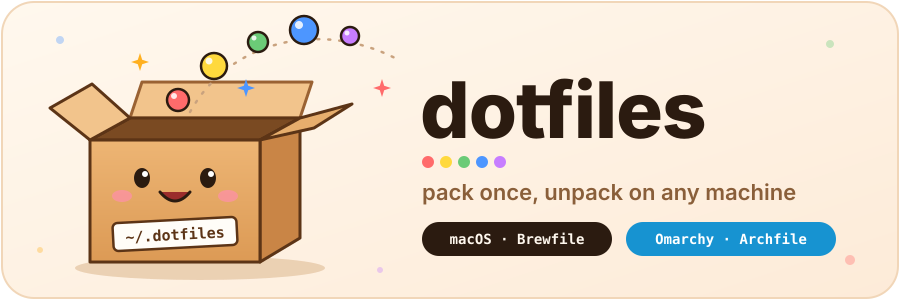

<p align="center">
  
</p>

<p align="center">
  My shell, git, terminal and agent setup for <b>macOS</b> and <b>Omarchy</b> (Arch).<br>
  One command sets up a new machine. Another keeps it up to date.
</p>

---

## Quick start

On a **fresh Mac** (the first `git` call installs the Xcode command-line tools):

```bash
git clone https://github.com/italolelis/dotfiles.git ~/.dotfiles && ~/.dotfiles/install.sh --force
chsh -s /bin/bash   # macOS logs in to zsh by default
```

On a **fresh Omarchy** (run it from a terminal, since it asks for `sudo`):

```bash
git clone https://github.com/italolelis/dotfiles.git ~/.dotfiles && ~/.dotfiles/install.sh --force
```

Then open a new terminal. Then work through the [one-time setup](#one-time-setup).

> [!TIP]
> `install.sh` is safe to re-run. It skips anything already installed, and it moves any real file it would overwrite to `~/.backup/dotfiles_<timestamp>/` first.

## What the installer does

| Step | macOS | Omarchy |
|---|---|---|
| **Packages** | `brew bundle` from the [`Brewfile`](./Brewfile) | `arch-bundle` from the [`Archfile`](./Archfile) |
| **Shell** | bash, [starship](https://starship.rs) prompt from the `starship` package | bash on Omarchy's defaults (mise, fzf, zoxide, aliases), same prompt |
| **Config** | symlinks every package (`bash`, `git`, `tmux`, `k9s`, …) into `$HOME` with [GNU Stow](https://www.gnu.org/software/stow/) | same |
| **Dev tools** | node and gh from brew | node, gh, claude, codex and pi from [mise](https://mise.jdx.dev) |
| **Agents** | [pi](https://github.com/earendil-works/pi-coding-agent) plus its extensions, [cship](https://cship.dev) status line | same |
| **SSH keys** | Proton Pass SSH agent, started at login (LaunchAgent) | same (systemd user unit) |

## Day to day

| I want to… | Run |
|---|---|
| Pull the latest config and install anything new | `dot` |
| See what's missing on this machine (Omarchy) | `arch-bundle check` |
| See what I installed but haven't saved (Omarchy) | `arch-bundle dump` |
| See what's missing on this machine (macOS) | `brew bundle check --file=~/.dotfiles/Brewfile --verbose` |
| Upgrade the whole system (Omarchy) | `omarchy-update` |
| Re-run the full installer | `~/.dotfiles/install.sh --force` |
| Check the repo before committing (also the pre-commit hook and CI) | `dot-check` |

`dot` runs `git pull`, re-links every package, then installs what's new: brew upgrades on macOS, and `arch-bundle` plus `mise install` on Omarchy.

## Keeping a new app

Installed something you want on every machine? Save it here, or it only exists on this one.

**On macOS**, add a line to the [`Brewfile`](./Brewfile):

```ruby
brew "ripgrep"
cask "obsidian"
```

**On Omarchy**, let `arch-bundle` find it for you:

```bash
arch-bundle dump
```

```text
# Installed here but not in the Archfile. Add what you want to keep;
# mark the rest `ignore <pkg>` so dump stops listing it.
pacman obsidian
aur    some-tool-bin
```

Paste the lines you want into the [`Archfile`](./Archfile) and commit. `dump` already skips everything Omarchy installs by default, so the list is only what *you* added.

**mise tools** (Omarchy) save themselves: `~/.config/mise/config.toml` is a symlink into this repo, so `mise use -g <tool>` edits the tracked file. Commit the change.

> [!NOTE]
> Neither `brew bundle` nor `arch-bundle` uninstalls anything. Deleting a line only stops new machines from getting it. Remove it from this machine yourself.

### The Archfile format

One entry per line, `#` starts a comment:

```bash
pacman  sops                                  # official repos, and Omarchy's own repo
aur     flux-bin                              # AUR, through yay
omarchy ghostty install-terminal ghostty      # runs omarchy-install-terminal ghostty if ghostty is missing
ignore  cmake                                 # installed on purpose, never bundled; dump stays quiet
```

Use `omarchy` when Omarchy has an installer that does more than install the package. For example, `install-terminal` also makes Ghostty the default terminal, and `install-gaming-steam` installs the right GPU drivers first. Browse them with `ls /usr/share/omarchy/bin | grep install`.

## One-time setup

After the first install, by hand:

- [ ] **Proton Pass**: run `pass-cli login`. The SSH agent serves your keys from the "SSH Keys" vault after that. Until then, ssh can only use key files in `~/.ssh`.
- [ ] **GitHub**: run `gh auth login`, then switch this repo to SSH:
  ```bash
  git -C ~/.dotfiles remote set-url origin git@github.com:italolelis/dotfiles.git
  ```
- [ ] **macOS defaults**: run `~/.dotfiles/macos.sh`, then reboot.
- [ ] **macOS login shell**: run `chsh -s /bin/bash`. The installer warns you if you skipped this.

## Secrets: where they go

This repo is **public**. Nothing secret is ever committed.

| What | Where |
|---|---|
| Tokens, API keys, work env vars | `~/.localrc` (untracked, sourced by `.bashrc`) |
| SSH private keys | Proton Pass, never on disk or in `ssh/` |
| Real hostnames, IPs, ssh users | `~/.ssh/config.local` (untracked, included by `ssh/.ssh/config`) |
| Machine-specific git settings | `~/.gitconfig.local` (untracked, included by `git/.gitconfig`) |
| pi credentials | `~/.pi/agent/auth.json`, `~/.pi/agent/mcp.json` (never tracked) |

`bash/.bashrc` is tracked: never put a secret in it.

## How it works

Each top-level folder is a **stow package** whose contents mirror `$HOME`. Stow symlinks them into place:

```text
~/.dotfiles/bash/.bashrc                     →  ~/.bashrc
~/.dotfiles/mise/.config/mise/config.toml    →  ~/.config/mise/config.toml
~/.dotfiles/bin/.local/bin/arch-bundle       →  ~/.local/bin/arch-bundle
```

Edit the file in the repo, or edit through the symlink. Either way the change shows up in `git status`.

To add a new config, for example `~/.config/foo/config.toml`:

1. Create `foo/.config/foo/config.toml` here.
2. Run `dot`.

Every top-level folder is a package; `dot-packages` prints the list for this machine, and a package's own `README.md` (never linked into `$HOME`) holds its gotchas. Folders that aren't packages (`assets/`) or are Omarchy-only (`hypr/`) are listed in `bin/.local/bin/dot-packages`. Stow's flags live in [`.stowrc`](./.stowrc), so from the repo root a dry run is just `stow -nv foo`.

### Layout

```text
bash/       .bashrc (Omarchy's stock bashrc + essential exports), .bash_profile
git/        .gitconfig, .gitignore_global
tmux/       .tmux.conf
starship/   .starship.toml
cship/      Claude Code status line
ghostty/    Ghostty terminal config (both OSes; follows the Omarchy theme there)
herdr/      herdr multiplexer config: tmux-style keys and UI
hypr/       Hyprland keybinding overrides (Omarchy only)
wave-xlr/   Elgato Wave XLR volume keys + WirePlumber rule (Omarchy only)
k9s/        k9s config for the homelab cluster: skin, hotkeys, flux/stern plugins
pi/         pi agent settings (theme, model, extensions) + custom extensions
mise/       global mise tools: node, gh, claude, codex, pi
ssh/        ~/.ssh/config only (no keys, no real hosts)
misc/       .curlrc, .editorconfig, .inputrc, .wgetrc
bin/        dot, dot-packages, dot-check, arch-bundle
assets/     the logo up top

Brewfile    macOS packages          ┐
Archfile    Omarchy packages        ├ not stowed
install.sh  the installer           │
macos.sh    macOS system defaults   ┘
```

### pi

`pi/.pi/agent/settings.json` holds pi's extensions, theme and default model. The installer runs `pi install` for any extension that's missing. `pi install` and `pi remove` edit the tracked file, so extension changes show up in `git status`. Custom extensions are `.ts` files in `pi/.pi/agent/extensions/`. Drop a file in and pi picks it up.

### Omarchy's own config

Omarchy ships its own `~/.config/git/config`, `~/.config/tmux/tmux.conf` and `~/.config/starship.toml`. They stay in place, but `~/.gitconfig` and `~/.tmux.conf` from this repo take precedence. The prompt is `starship/.starship.toml` (via `STARSHIP_CONFIG`): Omarchy's look plus the kubernetes context and slow-command times.

### Debian / Ubuntu

`install.sh` also works on apt-based systems. It installs stow, starship, fzf, cship and pi without Homebrew, and skips the GUI apps.
